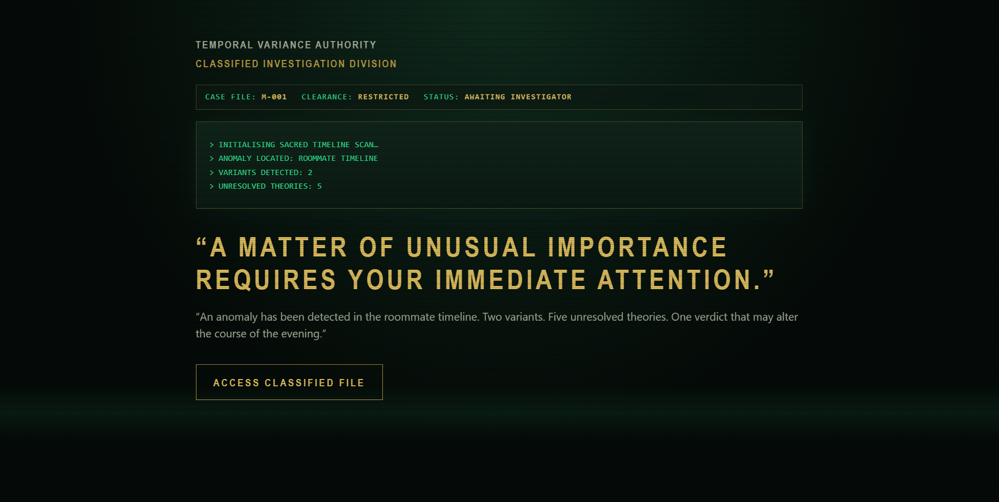
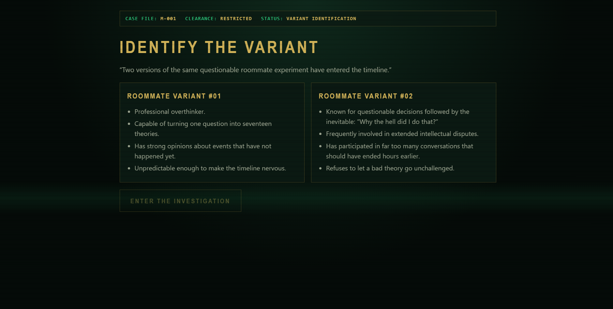
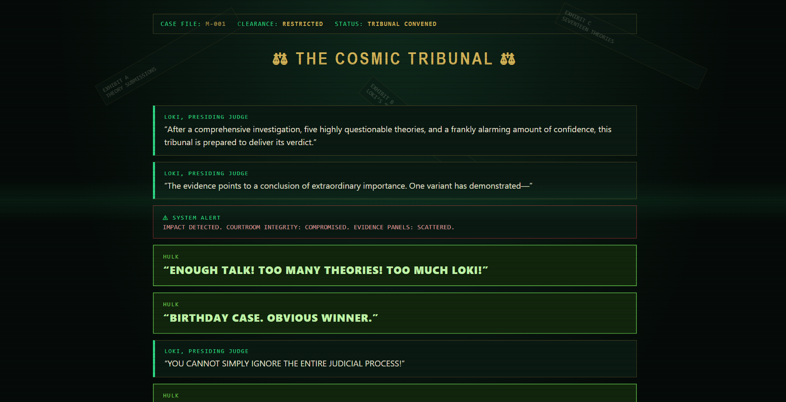
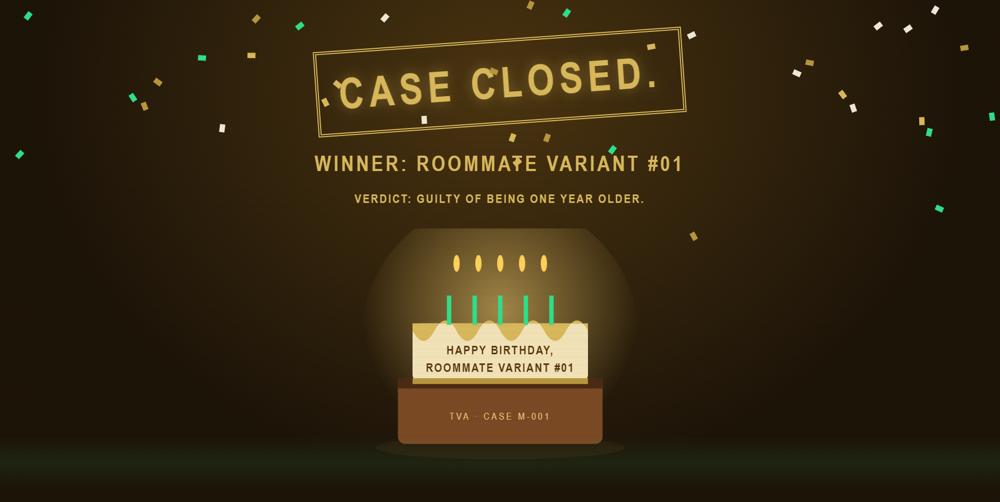
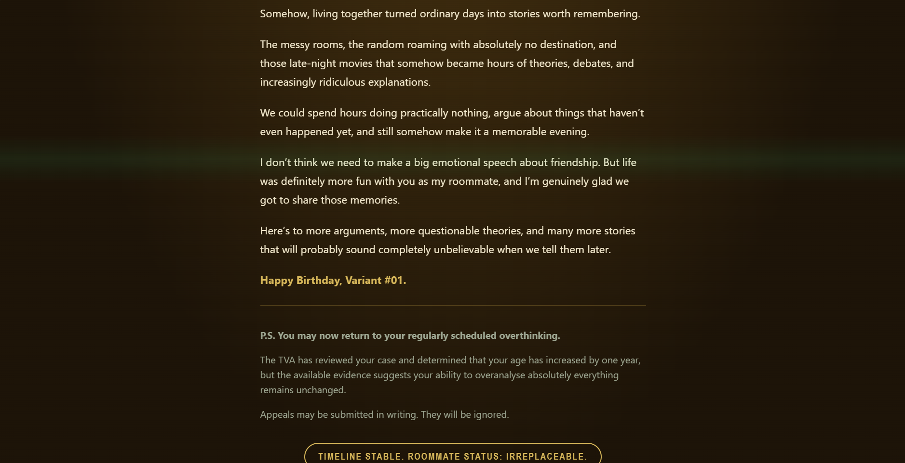

#  The Mahayudh Files

*One birthday. Five theories. A timeline full of memories.*

A little something made special by **Devansh Goyal**, who gifted me this interactive TVA-inspired birthday experience.

What begins as a classified investigation into the Maddock Horror Comedy Universe turns into a cosmic tribunal, questionable theories, Loki's commentary, Hulk's intervention, and a birthday surprise I wanted to keep forever.

This repository is my way of preserving that gift, not just as a website, but as a memory. ❤️

## Inside Case M-001

  
   <em>Every timeline has a story. This one starts with a classified file.</em>

  
   <em>Two variants. One questionable roommate experiment.</em>

  
   <em>Justice, Loki-style. Until Hulk has something to say.</em>

  
   <em>Guilty of being one year older.</em>

  
   <em>Some memories deserve their own timeline.</em>

## Built With

HTML · CSS · Vanilla JavaScript

To revisit the experience, open `The Mahayudh Files.html` in a modern browser with JavaScript enabled.

---

**Gifted by Devansh Goyal. Kept with gratitude.**

*CASE M-001: Archived. Timeline stable. Roommate status: irreplaceable.* ⚡